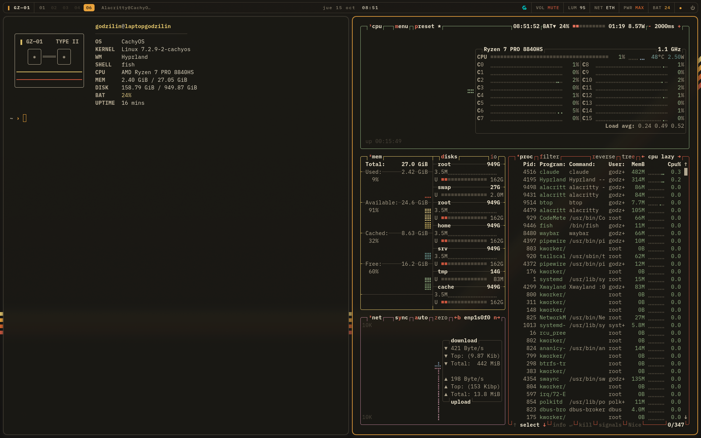
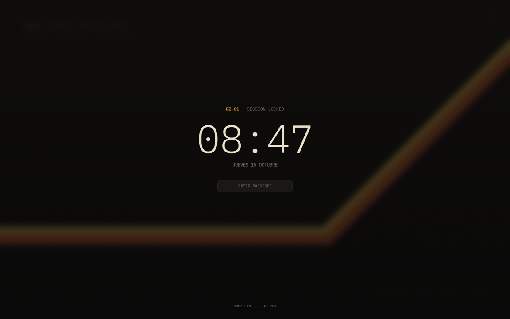
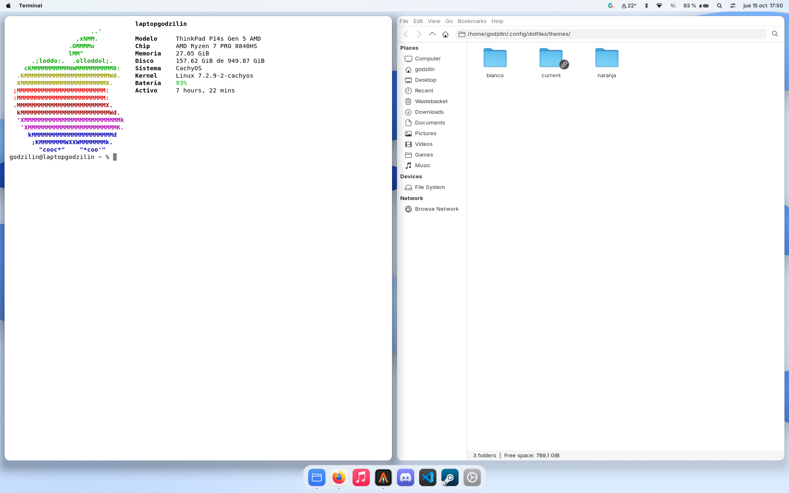
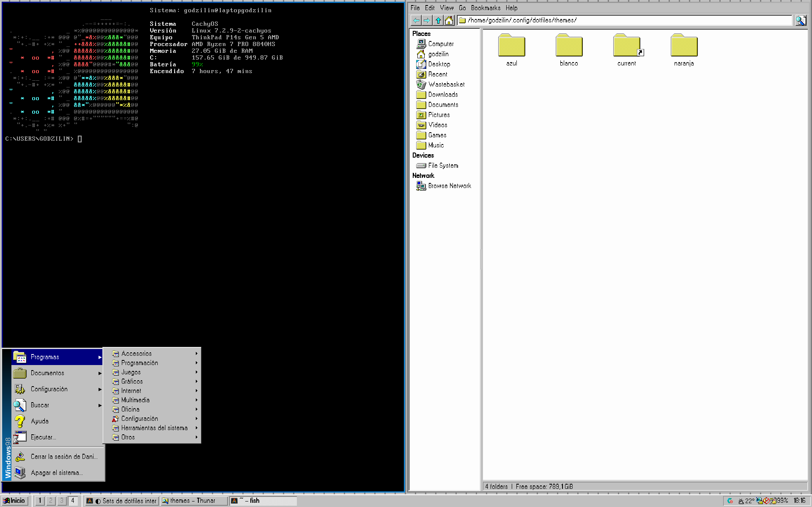
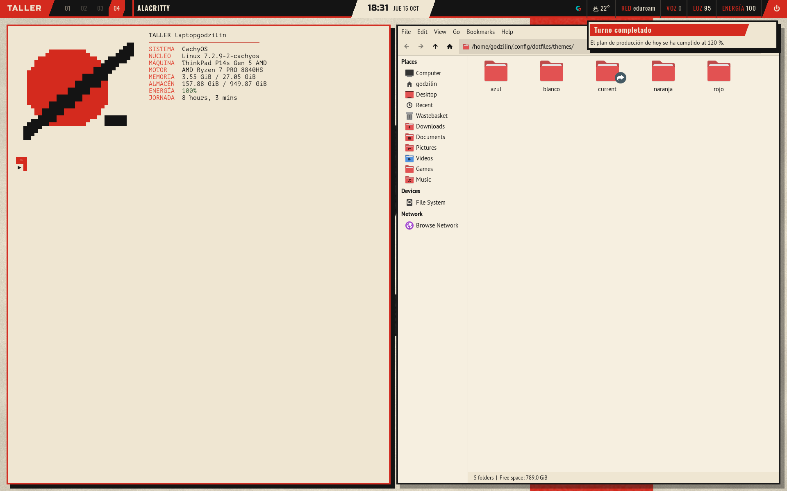
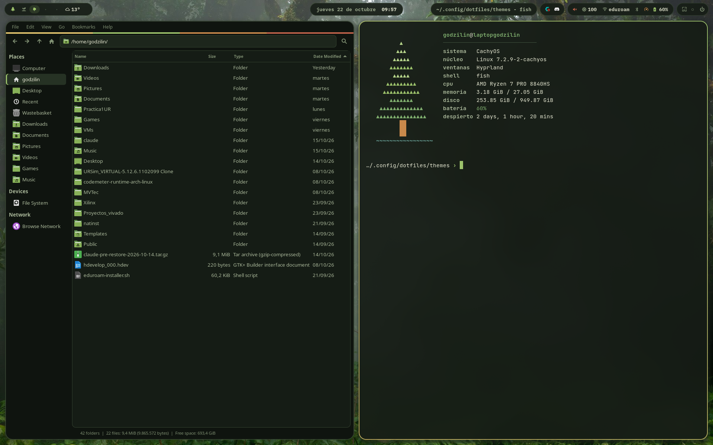
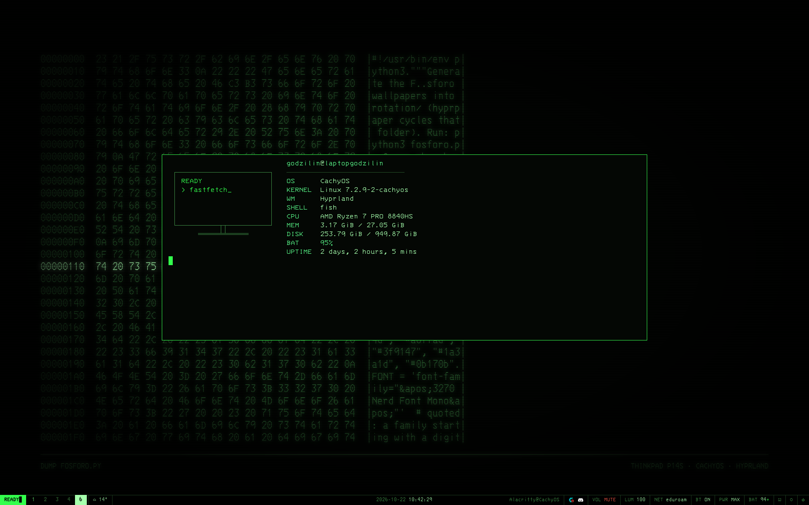
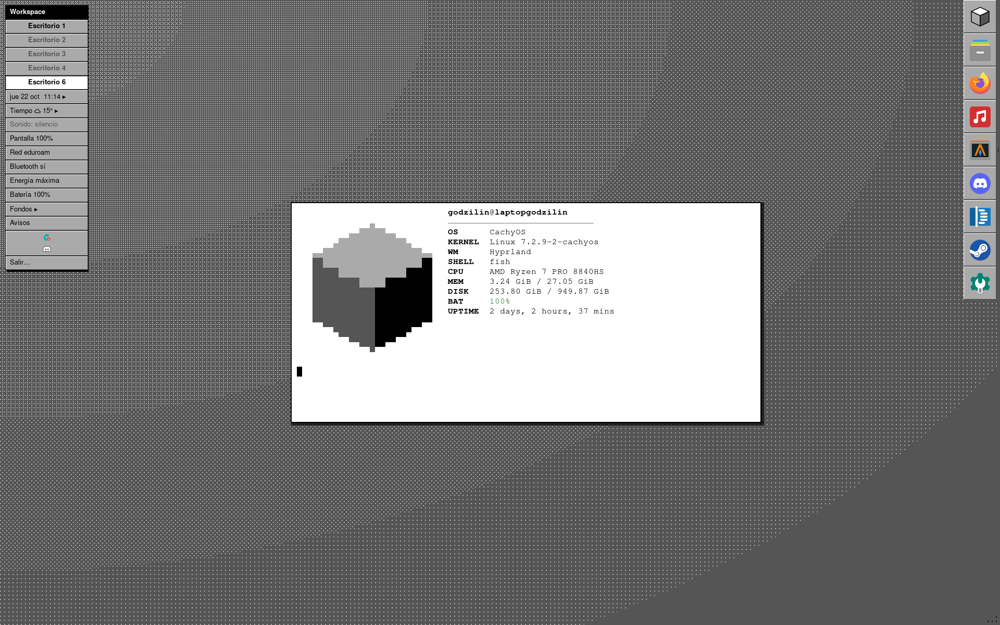

# dotfiles

Hyprland en un ThinkPad con CachyOS, con varios temas intercambiables: cada color es un estilo
distinto que cambia todo el escritorio (barra, ventanas, terminal, GTK/Qt, Firefox, fondos...).

```fish
tema            # lista los temas, * = activo
tema naranja    # cambia de tema y recarga lo que está abierto
```

| Tema | Estilo |
|---|---|
| `naranja` | **Nostromo**: cassette futurism con la calma de macOS |
| `blanco` | **macOS**: claro y translúcido, barra de menús con menú Apple, Dock, Spotlight |
| `azul` | **Windows 95/98**: biseles grises, barra de tareas, menú Inicio, MS-DOS Prompt |
| `rojo` | **Constructivismo**: papel, tinta negra y rojo de cartel; diagonales y tipografía condensada |
| `verde` | **Bosque**: musgo, luz entre pinos y corteza; barra de cantos rodados, fotos de Canarias, laurisilva y montaña |
| `negro` | **Fósforo**: terminal de fósforo verde; negro puro, todo en IBM 3270, barra como línea de estado |
| `gris` | **NeXTSTEP**: cuatro grises, biseles finos, menú vertical arriba a la izquierda y Dock a la derecha |

Firefox, Apple Music y las terminales ya abiertas cogen el tema nuevo al reiniciarlas; Obsidian cambia al momento,
pero las fuentes propias del tema (`fonts/`) solo las ve tras reiniciarlo
(si Firefox estaba abierto al cambiar, ciérralo y ejecuta `~/.config/dotfiles/firefox/theme.sh`).
Si un tema necesita algo de fuera (tema GTK, paquetes), `tema` avisa y su `themes/<color>/install.sh` lo instala.

## naranja: Nostromo

Base oscura cálida, ámbar de fósforo, franjas de cinta de casete y tipografía IBM Plex.




### Paleta

| | Color | Uso |
|---|---|---|
|  | `#121110` | fondo profundo |
|  | `#1a1814` | fondo |
|  | `#24211b` | superficies |
|  | `#3d382d` | líneas y bordes |
|  | `#857c69` | texto apagado |
|  | `#e8dfc8` | texto (crema) |
|  | `#e9a23b` | acento ámbar |
|  | `#e0c36a` | franja amarilla |
|  | `#d9652b` | franja naranja |
|  | `#c8553d` | franja roja / errores |

Fuentes: **IBM Plex Sans** (interfaz) y **BlexMono Nerd Font** (terminal, barra, lanzador).
Iconos: WhiteSur-orange-dark. Cursor: WhiteSur.

## blanco: macOS

Imitación de macOS Sonoma en claro: barra de menús translúcida (menú Apple, app activa en negrita, extras y reloj),
Dock con `nwg-dock-hyprland`, Spotlight con fuzzel, notificaciones y bloqueo como en macOS, Terminal.app "Basic"
con el prompt de zsh, Firefox tipo Safari con semáforos y fondos generados por código (`wallpapers/macos.py`).



Tema GTK [WhiteSur](https://github.com/vinceliuice/WhiteSur-gtk-theme) (versión fijada), iconos WhiteSur-light,
fuente Inter (lo más cercano a SF Pro que se puede distribuir) y DejaVu Sans Mono (la base de Menlo).
Primera vez: `~/.config/dotfiles/themes/blanco/install.sh`.

## azul: Windows 95/98

Barra de tareas con botón Inicio, botones de ventana y bandeja con los iconos auténticos; menú Inicio propio
(GTK3 + gtk-layer-shell) con la franja "Windows98", Programas por categorías, Documentos recientes, Configuración,
Buscar, Ejecutar y el diálogo "Apagar el sistema"; bordes con el degradado azul de la barra de título de Windows 98,
sin animaciones ni sombras; terminal "MS-DOS Prompt" con `C:\USERS\GODZILIN>`; inicio de sesión "Bienvenido a
Windows"; Firefox como Internet Explorer 4; notificaciones como ventanas de Windows; Qt con el estilo "Windows" de Qt.



Tema GTK, iconos y cursores [Chicago95](https://github.com/grassmunk/Chicago95) (commit fijado), fuente
[W95FA](https://fontsource.org/fonts/win95fa) (OFL, viene en el tema y solo existe mientras azul está activo) y
More Perfect DOS VGA para la terminal. Fondos generados por código (`wallpapers/win95.py`): verde azulado,
nubes, degradado de instalación, patrones de 8×8, arenisca, bloques rojos, burbujas, círculos, remaches azules,
ondas, estera de paja, baldosas, piedra tallada, y los salvapantallas Tuberías 3D, Campo de estrellas, Mystify y el
planeta de Plus! Espacio. Primera vez: `~/.config/dotfiles/themes/azul/install.sh`.

## rojo: constructivismo

Un cartel de los años 20 (Ródchenko, Lisitski, Klutsis): tres tintas, papel crema, negro y rojo. Barra como
franja negra con bloques rojos cortados en diagonal ("ЦЕХ", escritorios en numerales, reloj en un paralelogramo de
papel, lecturas "СЕТЬ / ЗВУК / СВЕТ / ЭНЕРГИЯ"); todo el texto del tema en ruso (`scripts/ru.sh` pone fechas y nombre en cirílico sin locale ruso); ventanas con marco rojo grueso y sombra de tinta dura desplazada;
animaciones mecánicas con rebote; terminal de papel e tinta con PT Mono; notificaciones y lanzador como tarjetas con
marco de tinta; bloqueo compuesto como un cartel; Firefox con pestañas en paralelogramo; carpetas rojas (Papirus).



Fuentes Oswald, Russo One, PT Sans y PT Mono (OFL, dentro del tema). Siete láminas generadas por código
(`wallpapers/constructivismo.py`): dos planchas de tinta sobre papel con grano, la roja algo fuera de registro, como en
una imprenta de 1925. Primera vez: `~/.config/dotfiles/themes/rojo/install.sh` (Papirus y el tema de iconos con carpetas rojas).

## verde: Bosque

Un bosque al atardecer: base verde casi negra, musgo, luz de sol, corteza y bayas. La barra no es una barra: son
"cantos rodados" redondeados que flotan sobre el fondo, con iconos de hojas (cada escritorio es un brote; en el
que estás ha crecido un árbol). Bordes de ventana con degradado musgo→sol, esquinas muy redondas y animaciones
lentas con un pequeño rebote, como hojas que se posan; bloqueo con la hora en Fraunces y saludo según la hora;
terminal con JetBrains Mono y una viñeta del Teide entre abetos en fastfetch (`fastfetch/make_logo.py`); carpetas verdes (Papirus-Verde).



Fuentes Nunito, Fraunces y JetBrains Mono (OFL, dentro del tema). Fondos: siete paisajes generados por código
(`wallpapers/bosque.py`: niebla entre abetos, luciérnagas, helechos, curvas de nivel, lago, hojas, amanecer) y
treinta fotos de Wikimedia Commons (`wallpapers/fotos.py`: medio Canarias —Anaga, Teno, Garajonay, Caldera de
Taburiente, pinar canario, Teide, Dragos Gemelos— más laurisilva de Madeira, hayedos, secuoyas, Pirineos, Picos de
Europa, fiordos...) con el lugar, autor y licencia en una esquina; créditos en
`wallpapers/FOTOS.md`. Primera vez: `~/.config/dotfiles/themes/verde/install.sh`.

## negro: Fósforo

Una terminal de mainframe con fósforo verde P1: negro puro, un solo verde en varias intensidades (el rojo solo para
errores) y todo en la fuente IBM 3270, también la interfaz. Ventanas cuadradas de borde fino, sin sombras, sin blur
y sin animaciones: la pantalla se redibuja y ya. La barra va abajo como la línea de estado de tmux o de un 3270
(`READY▮` abre el lanzador, escritorio activo en vídeo inverso, reloj con segundos); el lanzador es un prompt
`READY.` con selección invertida, y el bloqueo es una pantalla de logon (`USERID ===>`, `PASSWORD ===>`).
Firefox, Thunar, GTK y Qt van con la misma paleta, y las franjas del Nostromo pasan a ser cuatro intensidades de verde.



Fuente `ttf-3270-nerd` (repos oficiales), carpetas verdes (Papirus-Verde, la del tema verde), cursor Capitaine.
Fondos generados por código con brillo de fósforo y líneas de barrido (`wallpapers/fosforo.py`: READY, volcado
hexadecimal del propio script, osciloscopio, radar y terreno vectorial). Primera vez: `~/.config/dotfiles/themes/negro/install.sh`.

## gris: NeXTSTEP

Los cuatro grises de la pantalla de 2 bits de NeXT (negro, gris oscuro, gris claro, blanco) y el rojo solo para
errores. La barra es el menú principal de NeXT: una columna estrecha arriba a la izquierda con el título negro
`Workspace` (abre el lanzador), un escritorio por fila (el actual en blanco, como una selección) y filas con
bisel para reloj, tiempo, música, sonido, red, batería, fondos, avisos y `Salir…`; las que abren un panel llevan `▸`.
El Dock (`nwg-dock-hyprland`) baja por el borde derecho en casillas cuadradas con bisel, con un cubo gris para el
lanzador y puntitos junto a los programas abiertos. Ventanas cuadradas con marco negro y sombra dura, barras de
título GTK negras con el título en blanco, terminal negro sobre blanco y bloqueo como el panel de login de NeXT.
Botones con bisel, campos de texto hundidos y scrollers de canal gris oscuro también en GTK, Thunar (el File
Viewer), los paneles de fondos y música y el centro de avisos (con título negro). Firefox es una ventana de OmniWeb:
las pestañas son los títulos de la barra negra (centrados, la abierta en negrita, miniaturizar y cerrar como
cuadros grises), fila de botones con bisel y campo `URL:`, la página hundida y la barra de redimensionar con sus dos
muescas abajo. En Obsidian cada panel tiene su barra de título negra (gris oscuro si no es el activo), una fila de
botones gris debajo y los scrollers a la izquierda, como en NeXT.



Nimbus Sans y Nimbus Mono PS (`gsfonts`, los clones URW de Helvetica y Courier), carpetas grises (Papirus-Gris,
la construye `install.sh`), cursor Capitaine. Fondos generados y tramados con Bayer a los cuatro grises
(`wallpapers/next.py`: Workspace, cubo negro, esferas, Mandelbrot, degradado, superficie de Mathematica, roseta de
Display PostScript, toro, Julia, ciudad de cubos, Lorenz, moiré, curvas de nivel, galaxia y Lissajous). Primera vez:
`~/.config/dotfiles/themes/gris/install.sh`.

## Cómo están organizados los temas

Cada tema vive en `.config/dotfiles/themes/<color>/` y `themes/current` (local, fuera de git) apunta al activo.
Las rutas que leen las apps (`.config/waybar/style.css`, `.config/hypr/look.lua`, `.config/gtk-3.0/gtk.css`...)
son enlaces a `themes/current/...`, así que cambiar de tema es mover ese enlace y recargar.
Lo común (atajos, reglas, scripts, música) existe una sola vez y lee los colores de `themes/current/theme.json`.

| En el tema | Qué es |
|---|---|
| `theme.json` | paleta, fuentes, iconos, cursor, tema GTK y esquema KDE (lo aplica `tema`; lo leen los popups) |
| `hypr/` | `colors.lua`, `look.lua` (bordes, sombras, animaciones), `hyprlock.conf` |
| `waybar/`, `swaync/`, `fuzzel/`, `alacritty/`, `starship.toml`, `fish.fish` | barra, notificaciones, lanzador, terminal, prompt y colores de la shell |
| `gtk-3.0/`, `gtk-4.0/`, `kde/` | apps GTK y Qt |
| `firefox/`, `apple-music/` | `userChrome.css`/`userContent.css` + `user.js` |
| `obsidian/` | tema de Obsidian (`theme.css` + `manifest.json`); `tema` lo enlaza en el vault como `.obsidian/themes/Tema` |
| `popups/`, `fastfetch/`, `wallpapers/`, `screenshots/` | popup de música, logo, fondos generados por código |
| `scripts/`, `nwg-dock-hyprland/`, `install.sh` | extras propios del tema (menú Apple, Dock, menú Inicio) y su instalación |
| `scripts/launcher.sh` | si existe, es lo que abre la tecla Super (azul: menú Inicio); si no, fuzzel |
| `fonts/` | fuentes que solo se ven con ese tema (`.config/fontconfig/conf.d/60-theme-fonts.conf`) |
| `"qt_style"` en `theme.json` | estilo de widgets Qt (azul: `Windows`); sin él, Breeze |
| `"daemons"` en `theme.json` | programas que solo corren con ese tema (el Dock); `tema` los para y arranca |

## Qué hay

| Ruta | Qué es |
|---|---|
| `.config/hypr/` | Hyprland en Lua (0.56+), hypridle, hyprpaper, scripts. Chuleta de atajos en su `README.md` |
| `.config/waybar/scripts/` | Módulo de música de la barra |
| `.config/fish/` | Shell; `functions/tema.fish` cambia de tema |
| `.config/dotfiles/firefox/install.sh` | Enlaza el tema activo de Firefox en cada perfil (una vez, con Firefox cerrado) |
| `.config/dotfiles/firefox/theme.sh` | Activa en cada perfil el tema integrado que pide su `user.js` (`tema` lo llama; Firefox ignora `activeThemeID` una vez guardado un tema) |

## Instalar

```fish
git clone --bare https://github.com/godzilin/dotfiles.git ~/.dotfiles
function dots; git --git-dir=$HOME/.dotfiles --work-tree=$HOME $argv; end
dots checkout          # si se queja de archivos existentes, muévelos antes
dots config status.showUntrackedFiles no
sudo pacman -S --needed - < ~/.config/dotfiles/packages.txt
tema naranja           # crea themes/current y aplica GTK, Qt, iconos y cursor
```

Los iconos WhiteSur-orange salen de [vinceliuice/WhiteSur-icon-theme](https://github.com/vinceliuice/WhiteSur-icon-theme)
(`./install.sh -t orange`).

## Filosofía (para que no se rompa)

- Solo paquetes de los repos oficiales. Sin `-git`, sin plugins de Hyprland.
- Config pequeña y en módulos. Tras cada cambio: `Hyprland --verify-config`.
- KDE sigue instalado como sesión de respaldo.
- Snapshots de btrfs con snapper antes de cada actualización.
